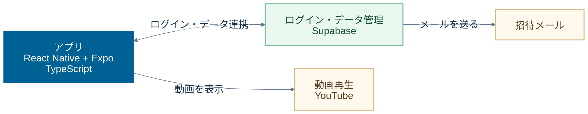

# 構成図

使用している主な技術を、アプリ・データ管理・メール・動画の4つにまとめています。

- [PNG画像](architecture.png)：資料への貼り付け用
- [SVG画像](architecture.svg)：拡大しても鮮明な画像
- [Mermaidソース](architecture.mmd)：編集用

## Mermaid記法

[Mermaid Live Editor](https://mermaid.live/)に貼り付けて、編集や画像の保存ができます。

